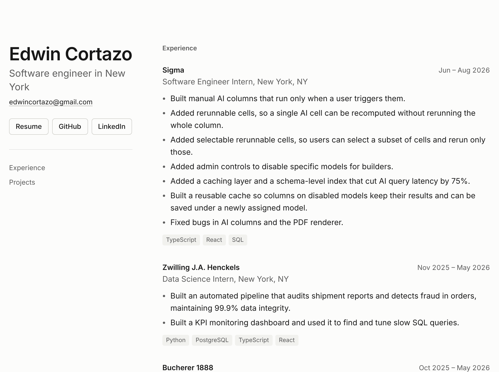
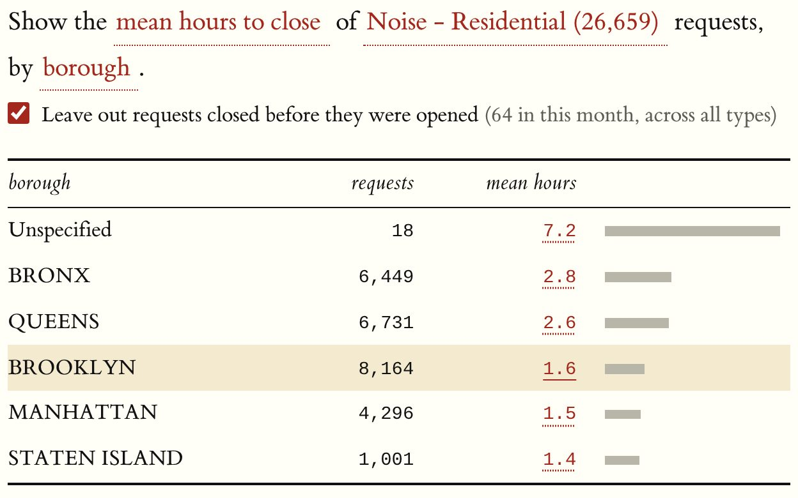
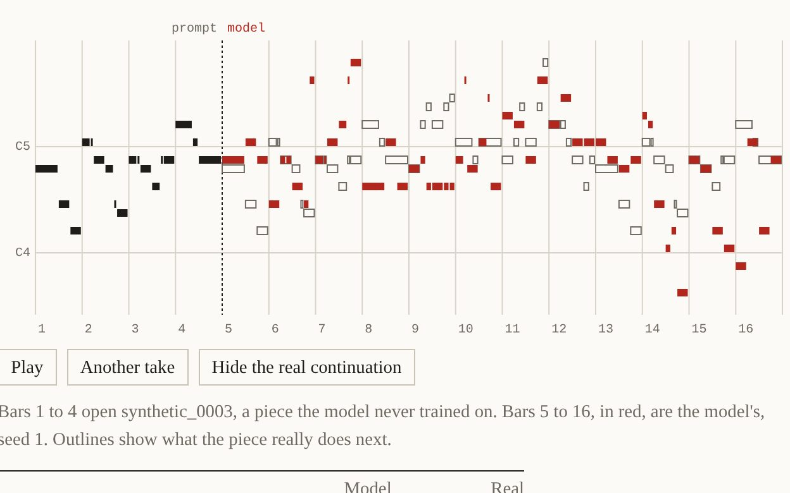
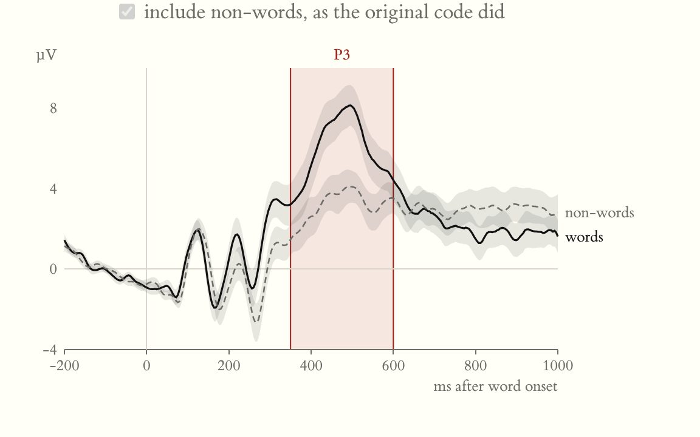
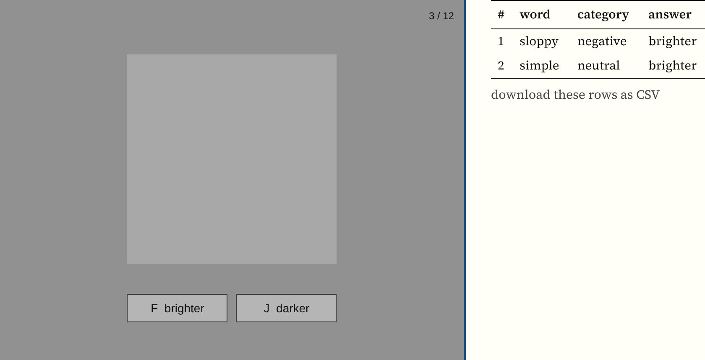
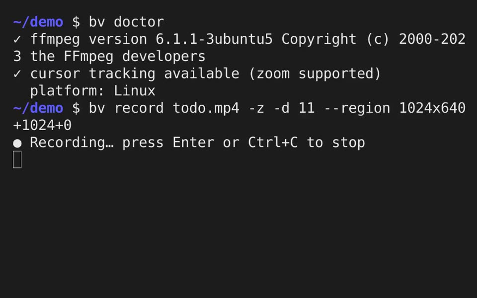
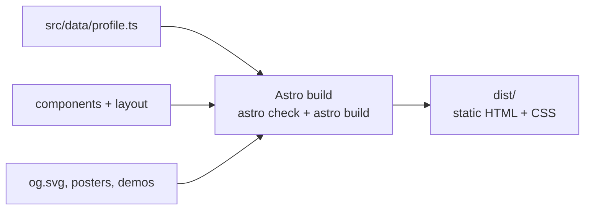
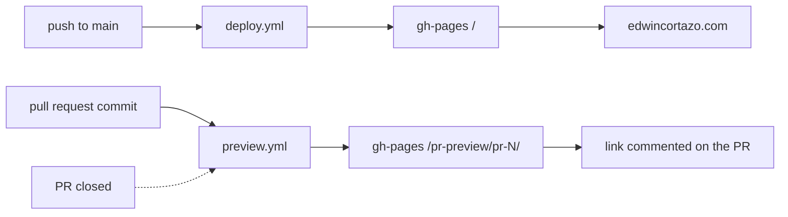

<div align="center">

# Hey, I'm Edwin 👋

<a href="https://edwincortazo.com">
  
</a>

**This repo is [edwincortazo.com](https://edwincortazo.com)**: my experience, projects, and resume on one fast little page.

[](https://edwincortazo.com)
[](public/Edwin_Cortazo_Resume.pdf)
[](https://github.com/Edwin580)
[](https://www.linkedin.com/in/edwin-cortazo)

[](https://github.com/Edwin580/edwin-site/actions/workflows/deploy.yml)


<a href="https://edwincortazo.com">
  <picture>
    <source media="(prefers-color-scheme: dark)" srcset=".github/screenshots/readme-hero-dark.png">
    
  </picture>
</a>

<sub>Switch GitHub between light and dark mode and the screenshot follows. Click it to open the live site.</sub>

[About me](#-about-me) · [Projects](#-projects) · [Run it locally](#-run-it-locally) · [How it's built](#-how-its-built) · [Deploys](#-deploys)

</div>

---

## 🙋 About me

```ts
const edwin = {
  basedIn: 'New York 🗽',
  speaks: ['TypeScript', 'Rust', 'Python', 'R', 'SQL'],
  background: 'cognitive science → software',
  likes: ['fast things', 'exact answers', 'receipts 🧾'],
  lastSeen: 'at Sigma, making AI columns rerun on command',
};
```

### 🧭 Pick your path

| If you're... | Start here |
| --- | --- |
| 💼 Hiring | [Resume (PDF)](public/Edwin_Cortazo_Resume.pdf) or [the site](https://edwincortazo.com) |
| 🦀 Into systems | [Receipts](https://edwin580.github.io/receipts-engine/): 7.1M rows, verified and traced in your browser |
| 📚 Got a book to finish | [Chapter](https://edwin580.github.io/RSVP-Reader/): one word at a time, at your WPM |
| 🎹 Feeling musical | [Music Generation](https://edwin580.github.io/music-generator/): give it a melody, it keeps going |
| 🧠 A science nerd | [Does Morality Pop Out?](https://edwin580.github.io/EEG-Study-Replication/): I found a bug in the published analysis |

<details>
<summary><b>📊 By the numbers</b> (click me)</summary>

| | |
| ---: | --- |
| **1,700+** | Lowe's stores running ProRange, which I built and shipped |
| **75%** | less AI query latency at Sigma, from a cache and a schema-level index |
| **7.1M** | rows Receipts loads and hash-checks in your browser in under 2 seconds |
| **1e-12** | how closely my JavaScript GEE port matches R |
| **196 + 67** | unit and end-to-end tests guarding Chapter |
| **0 KB** | JavaScript this site sends to your browser |

</details>

---

## 🧪 Projects

Things I built because I wanted them to exist. Click a preview to try one, or open a summary below to see how it works.

<table>
  <tr>
    <td align="center" width="33%">
      <a href="https://edwin580.github.io/receipts-engine/"></a><br>
      <b>Receipts</b><br><sub>Rust · WebAssembly · Arrow</sub>
    </td>
    <td align="center" width="33%">
      <a href="https://edwin580.github.io/RSVP-Reader/"></a><br>
      <b>Chapter</b><br><sub>React · TypeScript · pdf.js</sub>
    </td>
    <td align="center" width="33%">
      <a href="https://edwin580.github.io/music-generator/"></a><br>
      <b>Music Generation</b><br><sub>Python · PyTorch</sub>
    </td>
  </tr>
  <tr>
    <td align="center">
      <a href="https://edwin580.github.io/EEG-Study-Replication/"></a><br>
      <b>Does Morality Pop Out?</b><br><sub>R · Quarto · JavaScript</sub>
    </td>
    <td align="center">
      <a href="https://edwin580.github.io/Prolific-Experiment/"></a><br>
      <b>Brightness Perception</b><br><sub>JavaScript · jsPsych</sub>
    </td>
    <td align="center">
      <a href="https://github.com/Edwin580/better-video"></a><br>
      <b>better-video</b><br><sub>Rust · Win32 · DXGI</sub>
    </td>
  </tr>
</table>

<details>
<summary><b>Receipts</b>: click any number computed from NYC 311 data and see the rows behind it</summary>

- A query engine in Rust, compiled to WebAssembly, over content-addressed Arrow IPC snapshots. The browser re-derives every BLAKE3 hash on load and refuses data that doesn't match.
- Captures lineage at every operator for backward and forward tracing, adding about 6% to execution time on 7.1M rows.
- Computes exact counterfactuals that match a full re-run bit for bit.
- [Live](https://edwin580.github.io/receipts-engine/) · [Source](https://github.com/Edwin580/receipts-engine)

</details>

<details>
<summary><b>Chapter</b>: an offline-first RSVP speed reader for EPUB, PDF, and text files</summary>

- Parses EPUBs with JSZip and PDFs with pdf.js in Web Workers, reading pages in parallel.
- Times each word against `performance.now()` deadlines so playback doesn't drift.
- Full-text search in a Web Worker over an `Int32Array` inverted index, with typo tolerance.
- [Live](https://edwin580.github.io/RSVP-Reader/) · [Source](https://github.com/Edwin580/RSVP-Reader)

</details>

<details>
<summary><b>Music Generation</b>: a Transformer melody model that runs in your browser</summary>

- Decoder-only Transformer with rotary embeddings and a sliding-window KV cache, compared against LSTM baselines.
- The demo reimplements the forward pass in JavaScript over 1.6 MB of float16 weights, parity-tested against PyTorch.
- [Live](https://edwin580.github.io/music-generator/) · [Source](https://github.com/Edwin580/music-generator)

</details>

<details>
<summary><b>Does Morality Pop Out?</b>: an EEG replication that refits its statistics in the browser</summary>

- Found a clustering bug in the original R analysis; fixing it changes one conclusion.
- Ported exchangeable-correlation GEE to JavaScript, matching 66 reference fits from R to about 1e-12.
- [Live](https://edwin580.github.io/EEG-Study-Replication/) · [Source](https://github.com/Edwin580/EEG-Study-Replication)

</details>

<details>
<summary><b>Brightness Perception</b>: does a word's emotional valence change how bright a gray square looks?</summary>

- A custom jsPsych plugin with `requestAnimationFrame` timing, run with participants on Prolific.
- Seeded randomization, a manipulation check, and d′ analysis in the browser and in Node.
- [Live](https://edwin580.github.io/Prolific-Experiment/) · [Source](https://github.com/Edwin580/Prolific-Experiment)

</details>

<details>
<summary><b>better-video</b>: a screen recorder for pull requests that zooms in on each click</summary>

- A native Windows engine with DXGI desktop duplication and a built-in GIF encoder.
- Zooms planned like an editor would cut them, on a critically damped spring.
- [Source](https://github.com/Edwin580/better-video)

</details>

The full write-ups live in [`src/data/profile.ts`](src/data/profile.ts) and on [the site](https://edwincortazo.com/#projects).

---

## 🚀 Run it locally

```sh
npm install
npm run dev      # http://localhost:4321
npm run build    # astro check + static build to dist/
```

<details>
<summary><b>✏️ Editing content</b></summary>

- All content lives in [`src/data/profile.ts`](src/data/profile.ts). Edit roles, projects, and links there.
- The link-preview card is [`src/assets/og.svg`](src/assets/og.svg) (text only); it is rasterized to a JPEG at build time.
- The `EC` icons in `public/` come from [`public/favicon.svg`](public/favicon.svg). Rerun [`scripts/icon.mjs`](scripts/icon.mjs) after changing the icon.
- Project demo videos are recorded with [`scripts/demos/`](scripts/demos/README.md).

</details>

<details>
<summary><b>🗂️ Repo map</b></summary>

```
src/
├── data/profile.ts        ← every role, project, and link
├── components/            Experience.astro, Projects.astro
├── layouts/Base.astro     <head>, meta tags, JSON-LD
├── pages/index.astro      the one page
├── styles/global.css
└── assets/                og.svg, project posters, demo videos
public/                    resume PDF, icons, robots.txt, sitemap.xml
scripts/                   icon.mjs, demos/ (recording scripts)
.github/workflows/         deploy.yml, preview.yml
```

</details>

---

## 🧱 How it's built

Astro renders everything to plain static HTML and CSS. It uses system fonts and ships no JavaScript to the browser.



---

## 🌐 Deploys



- **Production:** every push to `main` builds the site and publishes it to the `gh-pages` branch, served at
  `https://edwincortazo.com` ([`deploy.yml`](.github/workflows/deploy.yml)).
- **Previews:** every commit on a pull request is published to
  `https://edwincortazo.com/pr-preview/pr-<number>/`, and a comment on the PR links to it
  ([`preview.yml`](.github/workflows/preview.yml)). Previews are removed when the PR closes and aren't indexed by search engines.

<details>
<summary><b>⚙️ GitHub Pages settings</b></summary>

GitHub Pages must be set to **Settings → Pages → Source: Deploy from a branch → `gh-pages` / root**, with
**Custom domain** set to `edwincortazo.com`. The deploy keeps the `CNAME` file GitHub writes to `gh-pages`.

</details>

<div align="center">
<br>

**You scrolled all the way down. Let's talk!** ✌️

<a href="mailto:edwincortazo@gmail.com">edwincortazo@gmail.com</a>
</div>
